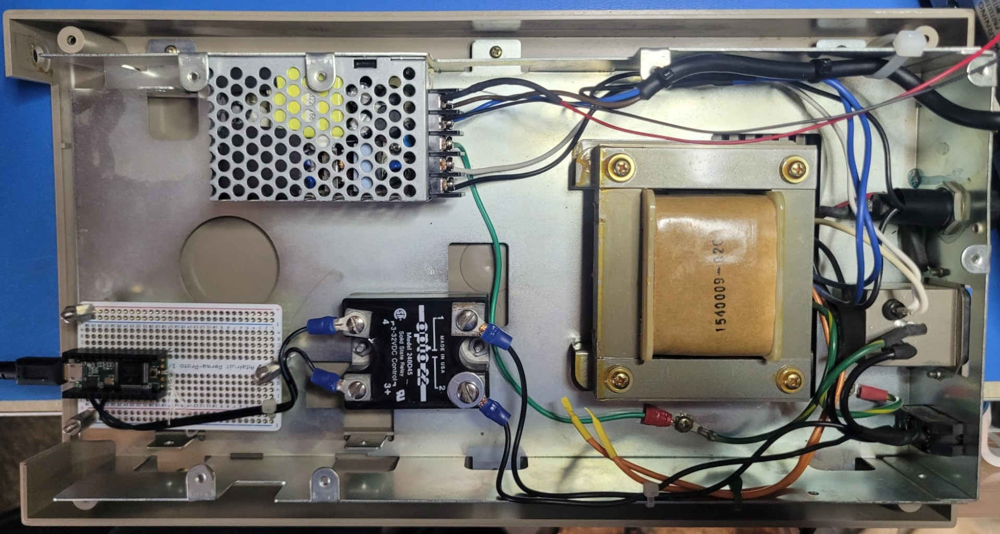

# Mains Relay

A USB-controlled mains switch for a bench power supply. A Teensy 3.1 drives a solid-state relay, and a host on the bench PC cuts and restores the supply's mains over USB serial. It was built so that [TReadmill](https://github.com/SensoriumEmbedded/treadmill), the hardware-in-the-loop suite for TeensyROM firmware, can power-cycle a C64 or C128 that no reset brings back. Nothing in it is specific to [TReadmill](https://github.com/SensoriumEmbedded/treadmill).

## Hardware



The supply is built into an old 1541's case. In the photo: the Mean Well RS-25-5 (top left), the 1541's transformer (right), the 240D45 relay (center), and the Teensy on its proto board (left) with its USB cable.

| Qty | Part | What it does |
|---|---|---|
| 1 | Commodore 1541, old or broken | The enclosure. Kept from the drive: the case, the 9 VAC transformer, the rear-panel AC inlet, power switch and fuse, and the LED. Everything else removed |
| 1 | Mean Well RS-25-5 AC-to-DC supply (323282) | The 5 VDC: single output, 5 V, 5 A, 25 W, 1.5" |
| 1 | Teensy 3.1 | The controller, mounted on the proto board. Powered from USB only |
| 1 | Proto board | Carries the Teensy |
| 1 | Opto 22 240D45 solid-state relay | Switches the mains. DC input: 3–32 V, 3 V pick-up, 1 V drop-out, 1,000 Ω nominal. Zero-voltage turn-on, 24–280 VAC load |
| 1 | C64 power supply cable | The output to the machine: the RS-25-5's 5 VDC and the transformer's 9 VAC |
| | Wire, hardware | Various |

## How it is wired


- **Mains**, 120 V: the relay's load terminals sit across the supply's single-pole power switch, which switches the hot (black) wire, ahead of the fuse: inlet → switch ‖ relay → fuse → supply.
- **Relay drive:** Teensy pin 2 straight to the relay's input +, Teensy GND to input −. The relay's input pulls a floating pin low, so the relay is off while the firmware isn't running.
- **Teensy power:** USB only, with no connection to the supply's DC outputs. The USB cable is the controller's only connection outside the case.

The supply's own switch is the bypass:

| Supply switch | Machine power |
|---|---|
| **ON** | Always on, whatever the controller does |
| **AUTO** (the switch's off position) | Decided by the controller: on while its firmware runs, off while a host holds it off or runs a power cycle |

On AUTO the supply's switch no longer turns the machine off while the controller has USB power. To turn the machine off for a cartridge or cable swap, use the machine's own switch or pull the plug.

The relay is off whenever the controller's firmware isn't running. That covers no USB power, a reflash, and the bootloader. Switch to ON for manual use and while reflashing the controller.

## Talking to it

Any serial terminal works. Find the port whose USB serial string is `MainsRelay_<chip id>`, open it at any baud rate except 134, and type:

```
?
CYCLE 1
```

`?` identifies the controller and reports each channel's state. `CYCLE 1` cuts channel 1 for 5 seconds, then replies once power is back. `OFF 1 LATCH` (fw 1.1.0) turns channel 1 off until `ON 1`, with no host needed meanwhile: use it to leave a machine powered down overnight. [docs/Host_Protocol.md](docs/Host_Protocol.md) is the full contract: every command, the replies, and what happens to the power when the host goes away.

## Building and testing

The sketch is `firmware/MainsRelay/`, for a Teensy 3.1 or 3.2 with Teensyduino 1.61:

```
arduino-cli compile --fqbn teensy:avr:teensy31 firmware/MainsRelay
```

`RelayPins` in `Pins.h` names the relay's pin: pin 2, as wired here. Switch the supply to ON before you reflash: the relay is off while the Teensy is in its bootloader.

The protocol tests run the firmware's own engine on the PC, with a simulated clock and relay. They need Node.js and a `c++` compiler on `PATH`:

```
node --test "firmware/MainsRelay/tests/*.test.mjs"
```

## Safety

> **Warning: this project switches 120 V mains.** Mains voltage can kill. A wiring mistake can start a fire or put mains voltage on the machine, the case or the USB cable, and through the USB cable on the PC. Build or open it only if you are competent to work on mains wiring.

- Unplug the mains cord before opening the case. The supply's switch is not an off switch here: on AUTO the relay decides, and the supply is live whenever the controller has USB power.
- A solid-state relay is not an isolator. With the relay off, a small leakage current still flows through it, so the machine's side is never completely dead while the cord is plugged in.
- The relay's screw terminals and the switch, fuse and inlet terminals are bare mains. Use insulated terminals, and keep the case closed while the cord is plugged in.
- Keep the inlet's earth bonded to the metal chassis, and keep the fuse in the circuit, after both the switch and the relay.
- The Teensy takes power from USB only, and connects to nothing in the case except the relay's control input, which is isolated from the mains side. Powered from the supply it switches, a power cycle would cut the controller's own power, and the machine would never come back.
- Keep the Teensy and its wiring clear of the mains side, and strain-relieve the USB cable where it leaves the case.
- Nothing a host does by accident can leave the machine off for long while the firmware runs. A power cycle ends on the controller's clock, a hold-off ends at its limit (10 minutes by default, an hour at most), and a host that closes the port or sleeps gets the power back on. The exception is deliberate: `OFF <ch> LATCH` keeps a channel off until `ON <ch>` or a controller reset, for powering a machine down overnight with no host attached. See "Power behavior" in the protocol.

## Layout

| Path | What |
|---|---|
| `docs/Host_Protocol.md` | The USB serial protocol (proto 1) |
| `firmware/MainsRelay/` | The Teensy sketch; `tests/` runs its protocol engine on the PC |
| `hardware/` | The wiring diagram and the photo |

## Disclaimer

This is a personal bench project, documented as built. It is not a product, and it is neither certified nor tested for electrical safety. It comes with no warranty of any kind; see [LICENSE](LICENSE). If you build anything from it, you do so at your own risk, and you are responsible for meeting your local electrical codes.

## License

MIT; see [LICENSE](LICENSE).
